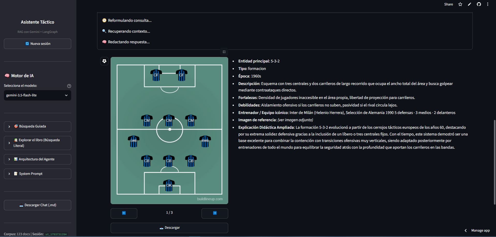
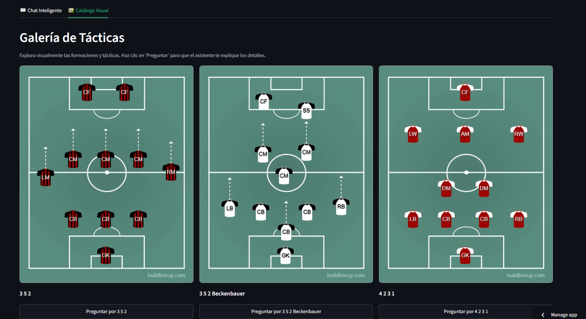
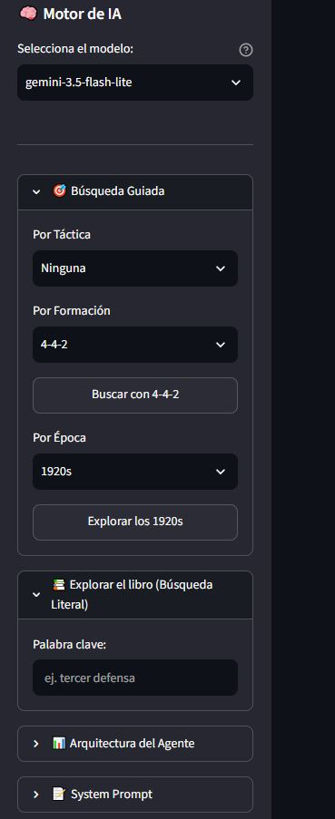
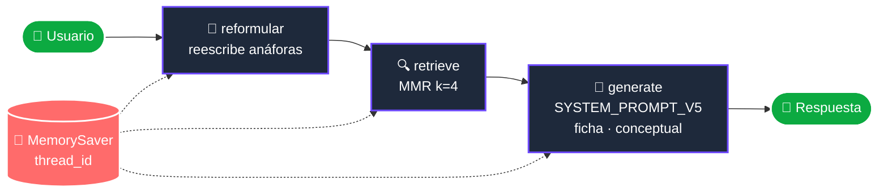

# ⚽ Asistente Experto en Tácticas de Fútbol (RAG + LangGraph + Streamlit)

Agente de IA generativa con RAG sobre táctica futbolística histórica y moderna: corpus híbrido de 123 documentos, memoria multi-turno y app Streamlit desplegada en la nube.

> Caso práctico del módulo de IA Generativa — pieza de portafolio.


---

## 📌 Qué responde

- **¿Qué es el Catenaccio y qué formación base usaba?** → formato estructurado + ficha visual
- **¿Y su entrenador?** → reformulador resuelve anáforas contra el histórico
- **¿Cómo evolucionó el 4-4-2 hacia el Gegenpressing?** → RAG sobre las tres capas
- **¿Qué equipos usaron el 5-3-2?** → filtro `tipo=formacion` en el catálogo curado
- **¿Qué era el "tercer defensa" en los 50?** → modo conceptual: el LLM explica del libro sin alucinar

## 🖼️ Vistazo al asistente

🚀 **Demo pública:** <pendiente-url-streamlit-cloud>

| Chat Inteligente | Catálogo Visual | Búsqueda Guiada (sidebar) |
|---|---|---|
|  |  |  |

## 📚 Pirámide de Datos (corpus híbrido)

| Capa | Fuente | Docs | Para qué sirve |
|---|---|---|---|
| **Histórica** | *La pirámide invertida* (J. Wilson), troceada por ≥1500 chars | **104** `.md` · `fuente=libro` | Contexto enciclopédico y evolución táctica |
| **Curada** | Fichas propias con metadata rica (`era`, `formacion_base`, `entrenador`, `imagen_url`) | **19** `.md` · `fuente=curado` | Precisión factual y atributos estructurados |
| **Contemporánea** | Scraping `trafilatura` (ej. Ajax 1972) | 1 `.md` · `fuente=scraping` | Extensibilidad sin tocar el grafo |

**Total: 123 docs** en ChromaDB (`tacticas_futbol`), embeddings `gemini-embedding-2` (3072 dims).

Cada `.md` cumple un **contrato de front matter** común (`id`, `fuente`, `era`, `imagen_url`, ...). Detalle en *Decisiones de chunking*.

## 🧱 Metodología — pipeline RAG con memoria



1. **Ingesta** — libro troceado por ≥1500 chars; curados y scraping íntegros (unidad semántica).
2. **Indexación** — `gemini-embedding-2` (3072 dims) en `chroma_db_v4/` con control de TPM. En Cloud: `build_chroma()` efímero con `@st.cache_resource`.
3. **Retrieval** — reformulador (solo ≥2 turnos) + MMR `k=4` sobre Chroma.
4. **Generación** — `SYSTEM_PROMPT_V5`: modo **Ficha** (formato estricto) o **Conceptual** (explicación narrativa del libro). Memoria por `thread_id` con `MemorySaver`.

## 🛠️ Decisiones técnicas destacadas

| Decisión | Qué se hizo | Por qué |
|---|---|---|
| **k=4 en retrieval** | `N_DOCS_RETRIEVAL = 4`, MMR con `fetch_k=10` | El curado canónico aparece **top-1 en 4/4 términos del dominio**. Más `k` añade ruido; menos pierde diversidad de capas |
| **`SYSTEM_PROMPT_V5`** | Ficha (formato estricto) vs Conceptual (explicar sin alucinar) | V2/V3 fallaba en conceptos narrativos del libro ("tercer defensa"). V5 separa modos con reglas distintas |
| **`build_graph(vs)` factory** | Grafo construido con el vectorstore como argumento; `get_default_graph()` con `lru_cache` | Cloud necesita vs efímero; notebook usa persistente. Sin factory, ambos caminos se pisan |
| **`PAUSA_FALLBACK_SEG` parametrizable** | Notebook: `15` s. Streamlit: `0` s (env var) | En local el rate limit se nota; en Cloud feedback instantáneo. Mismo código, dos entornos |
| **Imágenes locales** | 15 PNG de Buildlineup vía `imagen_url` relativa | Reproducibilidad > URLs externas. **Bonus**: filtra URLs de Wikipedia alucinadas por el LLM |
| **`chroma_db_v4` + `@st.cache_resource`** | Local lee de disco (0 API). Cloud reconstruye una vez y cachea | Cloud no escribe en disco. Doble modo evita quemar cuota de embeddings |
| **Reformulador solo ≥2 turnos** | 1 turno → query intacta. ≥2 → LLM reescribe anáforas | 1 LLM extra por turno ≥2 a cambio de que "¿Y su entrenador?" funcione |
| **`MemorySaver` + `thread_id`** | Una sesión = un `thread_id` = historial aislado | Cada pestaña independiente; *Nueva sesión* genera nuevo `thread_id` sin reiniciar grafo |

## 🚀 Demo pública

**URL:** [<pendiente-url-streamlit-cloud>](https://Asistente-experto-tacticas-futbol-rag-xuz7x9jvguray8lznairbf.streamlit.app/)


La app incluye tres modos de uso: **Chat Inteligente** (con memoria y trazabilidad de documentos), **Catálogo Visual** (galería interactiva de formaciones) y **Búsqueda Guiada** (explorador por filtros en la barra lateral). Se incluyen respuestas generadas en formato ficha y modo conceptua

3 preguntas de prueba:

1. `¿Qué es el Catenaccio y qué formación base usaba?` → ficha + imagen
2. `¿Y quién fue su entrenador?` → **memoria**: el reformulador resuelve
3. `¿Qué era el "tercer defensa" en el fútbol de los 50?` → **modo conceptual** (V5) desde el libro
4. `¿Qué equipos usaron el 5-3-2 y quién lo popularizó?` → consulta de atributos en metadata
5. `¿En qué se diferencia el Gegenpressing del Tiki-Taka?` → comparación cruzada de fuentes
6. `¿Qué es la táctica del Boca Juniors de 2020?` → **anti-alucinación** (`"Lo siento, esa información no se encuentra en mi base de datos táctica actual."`)


> Primer arranque Cloud: ~30-45 s (Chroma efímero). Después: ~2-5 s por consulta.

## 📂 Estructura del repositorio

```text
Asistente-Experto-Tacticas-Futbol-RAG/
├── .gitignore · LICENSE · README.md · requirements.txt
├── app.py                          # Streamlit: Chat + Catálogo Visual + Sidebar
├── src/                            # fuente única de verdad
│   ├── config.py · embeddings.py · vectorstore.py
│   ├── corpus.py · graph.py · chat.py
├── data/                           # 123 .md con front matter
│   ├── 00_libro/                   # 104 fragmentos — PDF NO se sube
│   ├── 01_clasicas_y_origenes/ · 02_futbol_total_y_catenaccio/
│   ├── 03_era_moderna/ · 04_contemporaneas/
│   └── imagenes/                   # 15 PNG (Buildlineup)
└── demo_asistente_tacticas.ipynb   # notebook pedagógico — importa de src/
```

## 🛠️ Herramientas

Python 3.13 · LangChain · LangGraph · ChromaDB · `langchain-google-genai` · Google Gemini (`gemini-embedding-2` + `gemini-3.5-flash-lite`) · Streamlit · PyMuPDF · PyYAML · trafilatura · python-dotenv

## ⚙️ Cómo reproducirlo

### Notebook

```bash
git clone https://github.com/<usuario>/Asistente-Experto-Tacticas-Futbol-RAG.git
cd Asistente-Experto-Tacticas-Futbol-RAG
python -m venv .venv && .venv\Scripts\activate
pip install -r requirements.txt
# Crear api.env en raíz → GOOGLE_API_KEY=tu_clave
# Abrir demo_asistente_tacticas.ipynb → Restart & Run All
```

### Streamlit local

```bash
python -m streamlit run app.py
```

> ⚠️ Siempre `python -m streamlit run`, no `streamlit run`: evita el `.exe` global sin dependencias del `.venv`. Es el gotcha más habitual en Windows.

### Streamlit Cloud

1. Push a repo público (`.gitignore` excluye `api.env`, `chroma_db*/`, PDF del libro y `.venv/`).
2. [share.streamlit.io](https://share.streamlit.io) → *"New app"* → conectar repo → `app.py`.
3. **Settings → Secrets:** `GOOGLE_API_KEY = "tu_clave"`.
4. Primera carga: ~30-45 s (Chroma efímero). Siguientes arranques: instantáneos mientras el proceso esté vivo.

### Notas sobre el corpus

- **El PDF del libro no se distribuye** (derechos de autor). Los 104 `.md` sí están, así que el proyecto funciona out-of-the-box. Para reconstruirlo, aporta el PDF y ejecuta `pdf_a_markdown`.
- **Añadir fuente nueva:** crear `.md` con contrato de front matter en `data/<capa>/` + `src.vectorstore.reindexar()`. Sin tocar el grafo.

## 🧠 Justificación del system prompt (V1 → V5)

**V1** — Prompt base: rol de historiador táctico + contexto + formato bullets.

**V2** — *Bug:* "¿Qué es el Catenaccio?" → respondía `Entidad principal: 5-3-2`. *Fix:* regla según `tipo` — `tactica` → nombre de la táctica; `formacion` → esquema numérico.

**V3** — *Bug:* "¿Qué formación base usaba el Catenaccio?" → *"No disponible en el registro"* pese a `formacion_base: "5-3-2"` en metadata. *Causa:* el LLM solo consideraba al `page_content` "contexto real". *Fix:* sección `# FUENTE DE VERDAD` declarando que metadata y prosa son ambas fuentes. Además, `nodo_generacion` renderiza metadata como lista legible.

**V4** — Primer intento de separación ficha/conceptual, aún difuso. Refinado en V5.

**V5** — *Bug:* "¿Qué era el tercer defensa en los 50?" → *"no está en mi BD"* pese a que el libro sí lo explicaba. El modo ficha de V3 era demasiado rígido para preguntas narrativas.

*Fix:* dos modos con reglas distintas:

| Modo | Activación | Comportamiento |
|---|---|---|
| **Ficha** | Doc curado `tipo=tactica/formacion` dominante | Formato estricto: Entidad, Tipo, Época, Descripción, Fortalezas, Debilidades, Entrenador/Equipo, Imagen |
| **Conceptual** | Fragmentos de libro dominantes o pregunta sin atributos | Explicación libre citando el fragmento. Prohibido inventar atributos |

**Anti-alucinación se mantiene:** si ni metadata ni prosa contienen el dato → *"Lo siento, esa información no se encuentra en mi base de datos táctica actual."*

## ✂️ Decisiones de chunking

Regla rectora: **trocear lo que no es unidad semántica; no trocear lo que sí lo es.**

| Capa | Estrategia | Por qué |
|---|---|---|
| **Libro** | Bloques ≥1500 chars → ~104 fragmentos | Sin TOC útil; 1500 chars = al menos una idea completa sin contaminar épocas vecinas |
| **Curados** | Sin chunking: 1 ficha = 1 doc | Unidad semántica autocontenida |
| **Scraping** | Sin chunking: 1 artículo = 1 doc | Misma lógica |

## ⚠️ Limitaciones y trabajo futuro

**Corpus** — 1 ficha de scraping real (extensibilidad > cobertura). PDF no distribuido.
**Agente** — sin router histórico/contemporáneo; reformulador = 1 LLM extra/turno; free tier (5 RPM, 1000 embeddings/día).
**UI** — catálogo visual estático (filtros solo desde sidebar); sin autenticación.

**Trabajo futuro:** portar `doc_a_md()` / `pdf_a_markdown()` a `src/corpus.py`; ampliar scraping (3-5 fuentes); router por `fuente`/`era`; tests `pytest` sobre nodos y loader.

## 🎓 Lecciones aprendidas

- **WinError 32 en Chroma** — no tocar `._client._system.stop()`. Usar directorios nuevos o `_get_client()` singleton.
- **`streamlit run`** — usar siempre `python -m streamlit run` (evita el `.exe` global sin dependencias).
- **`use_column_width` deprecado** en Streamlit 1.51+ → `width="stretch"`.
- **Alucinación de URLs** — el LLM inventaba URLs de Wikipedia. Fix: extraer imagen de metadata + regex en `app.py`.
- **`draw_ascii()` falla** → usar `draw_mermaid()` para visualizar el grafo.
- **Iteración del prompt como proceso** — V1 → V5: cada versión arregló un bug reproducible con una pregunta concreta. Documentar los bugs (no solo los fixes) es lo que hace defendible el proceso.

## 👤 Autor / Licencia

**Adrian Justo Carballal** — [portafolio](https://adrianjusto-data.github.io/)

Distribuido bajo licencia **MIT** — ver [LICENSE](LICENSE).

---

> Este proyecto usa materiales públicos con fines educativos y de portafolio. El corpus curado respeta la autoría de las fuentes originales (Jonathan Wilson para *La pirámide invertida*; Buildlineup para las imágenes de formaciones). Las conclusiones son orientativas y no sustituyen fuentes tácticas profesionales.
